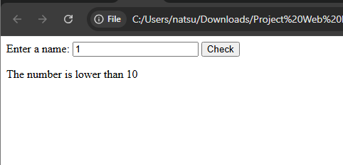
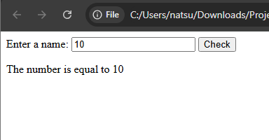
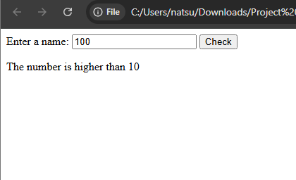
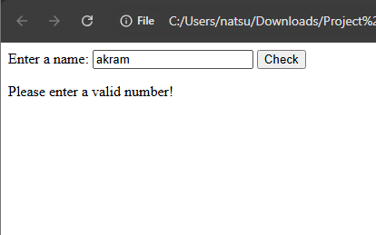
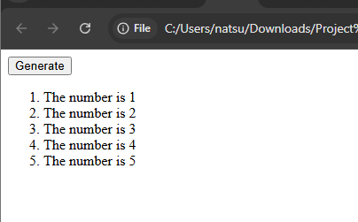

#Lab Assigment 4A

##Name: MUHAMMAD ARIFF AKRAM BIN ABDULLAH

##Matric.No: CI250087

##In this lab i learned about how javascript made the website interactive.

##To run each file you only need to open the html file of each question in your preferred browser. After you open the file you only need to click the button and see the output.

##Screenshot Output

###Question 1 : Interactive Text Changer

### 1. Question 1

### 2. Question 2

### 3. Question 3 
